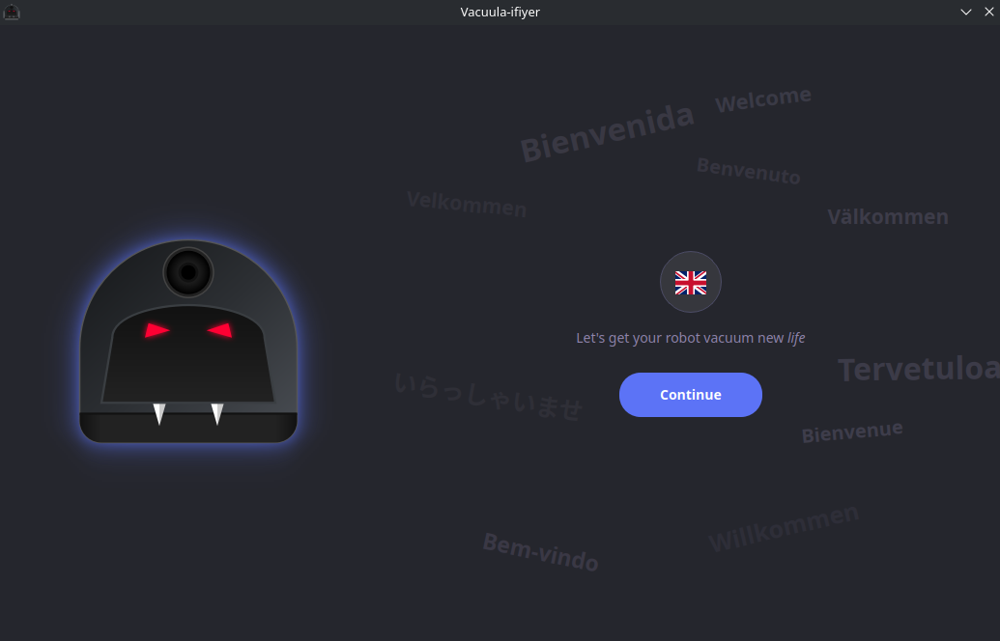

[buymeacoffee]: https://www.buymeacoffee.com/philip2809
[buymeacoffee-shield]: https://www.buymeacoffee.com/assets/img/custom_images/orange_img.png

  
  <h1>vacuula</h1>

_custom server for the undead robot vacuum cleaners_

[![Buy me a coffee][buymeacoffee-shield]][buymeacoffee]

  <h2>
      <a href="https://discord.gg/PAgwhWvyD8">
        Discord
      </a>
       | 
      <a href="#repair-my-robot" style="font-size:32px">
        Repair my robot!
      </a>
      <!--  | 
      <a href="https://tools.vacuula.phma.dev">
        Vacuula Tools
      </a> -->

> Vacuula is made as an all-in-one solution to repair and control your broken Neato Robot vacuum. 

| Gen1    | Gen2                   | Gen3 | Gen4     |
|---------|------------------------|------|----------|
| No WiFi | BotVac Connected: WIP¹ | D3 ✅ | D800 ✅   |
|         |                        | D4 ✅ | D8     ✅ |
|         |                        | D5 ✅ | D9     ✅ |
|         |                        | D6 ✅ | D10   ✅  |
|         |                        | D7 ✅ |          |

<i>Your robot not listed here? Get in touch!</i>
 <i>¹Sadly we were not able to fit the OG BotVac Connected into the initial release, sorry about this, support for this robot is in the works and here very soon!</i>

| Feature          | Status              |   | Feature              | Status |
|------------------|---------------------|---|----------------------|--------|
| Setup/Status     | ✅                   |   | Notifications        | 🚧     |
| Maps             | ✅                   |   | Home Assistant       | 🚧     |
| Historical runs  | ✅                   |   | Drag to clean "here" | 🚧     |
| Schedule         | ✅                   |   | Custom sounds        | 🚧     |
| Settings         | ✅                   |   | QoL improvements      | 🚧     |
| Zones/NoGo Lines | ✅                   |   | "Next day" Schedule  | 🚧     |
| MultiZones       | Gen4 ✅ Gen2/Gen3 🚧 |   |                      |        |

> [!NOTE]
> Do you have an Gen4 robot that is "rainbow-ing"? Different colors flashing and the robot does not start? Contact us in the [discord](https://discord.gg/PAgwhWvyD8). There we can help you repair your robot!

# Repair my robot!

For the repair there is two part
1. [Setup a server](#setup-server) <i>(we are looking into a community server, however that is not done in time for initial release, so you will need to set a server up)</i>
2. [Configure the robot](#configure-the-robot)

## Setup server

There is many ways to set this server up, however our recommended way is via Docker Compose. For users looking for standalone/lxc, please see [here](./build/lxc/lxc.md)
We provide you with a couple of ways to setup the server
- [Docker Compose (see below)](#docker-compose)
- As an App in Home Assistant
  - 
- [LXC/standalone](./build/lxc/lxc.md)

Since the server needs to always be on to work properly, you need some dedicated hardware for it. If you do not already have something to run the server on, please read about [hardware on the FAQ](./FAQ.md#dedicated-hardware)

### Docker compose
1. Install docker
    - <i>This is probably the hardest part for anyone unfamiliar with self-hosting, so we have started writing a [guide in the FAQ](./FAQ.md#install-docker)</i>
2. Download [`docker-compose.yaml`](https://github.com/vacuula/vacuula/releases/latest/docker-compose.yaml) or via `wget https://github.com/vacuula/vacuula/releases/latest/docker-compose.yaml` to save file onto server
3. Run `docker compose up -d`

- The server is configured by [envoriment variables](#configure-server)
- To see logs do `docker compose logs vacuula`
- To stop vacuula `docker compose down`
- To start vacuula `docker compose up -d`
- To permanently remove stored data `docker volume rm vacuula-data` <i>Vacuula needs to be stopped first</i>

## Configure the robot

We have made an easy to use installer to set your robot up!

> Dowload the latest version here for your OS here

| [Windows]() | [Linux]() | [Mac]() |
|---------|-------|-----|

<i>Source code is available at https://github.com/vacuula/installer</i>
 <i>If you have an more exotic setup and cannot run this installer in any way - get in touch and we will figure something out!</i>

## Configure server
### Ports used
| Port | Info                                  |
|------|---------------------------------------|
| 80   | Server, Webapp (Customizable)         |
| 443  | Gen3 robots, D3-D7 (Not customizable) |
| 3443 | Gen4 robots, D8-D10 (Customizable)    |

<i>Gen3 robots sadly require port 443, and if enabled, the vacuula server and webapp is also hosted here for PWAs to work </i>

### Configuration
| Option       | Default | Info                                                                                        |
|--------------|---------|---------------------------------------------------------------------------------------------|
| GEN4_PORT    | 3443    | Default port the Gen4 robots will connect to the server on                                  |
| VACUULA_PORT | 80      | Default port that you can reach the webapp/api on                                           |
| GEN3_ENABLED | True    | If server should support for Gen3 robots, can be useful since Gen3 devices require port 443 |
| GEN4_ENABLED | True    | If server should support for Gen4 robots                                                    |
| MDNS_ENABLED | True    | If server should run MDNS for autodiscovering                                               |